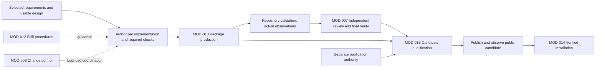

# Architecture composition

Model validation contract: model-document-v1

## Abstract

RigorLoop's current engineering definition starts at [design/](../README.md). Requirements define obligations, Features and Functions define logical behavior, and the [architecture index](README.md) composes accountable Modules and Interfaces. This supporting contract retains system-wide interaction, acceptance and shared test-policy clauses; it is not a separate System submodel.

Published skills guide bounded activities and the CLI performs explicit inspection, recording and installation. Individual skill use need not invoke the CLI. Change-managed recording uses the adopted CLI contract and project-local SQLite. Current engineering definitions remain repository files; operational storage does not own the engineering model.

## Architecture Overview

### Model hierarchy

The architecture has four responsibility trees: MOD-016 Project model, MOD-017 Change and quality control, MOD-018 Skills and commands, and MOD-019 Packaging and distribution. Their entity records own parentage and Function allocation. The [Logical view](views/browser/index.html#logical) derives those relationships; the former Skill/CLI/Engineering document grouping is not a competing hierarchy.

### Architecture overview convention

An owning Module's supporting contract or realization explains its decisions. Generated views project those sources without duplicating authority. Choose a diagram for the question: responsibility/dependency, runtime sequence/state, source organization or deployment. See [architecture views](views/README.md).

### Parent graph ownership

Each parent owns integration of its declared children; each child owns its detailed behavior. Cross-boundary relationships belong to the nearest common responsible parent. Keep names and endpoints consistent; leaf Modules need no artificial child graph. SYS-SR-10 preserves this responsibility rule, independent of physical document layout.

### Repository directory layout

Follow [Engineering definition ownership](../support/ownership.md). `design/requirements/`, `design/system/` and `design/architecture/` own current model facts. Module/Interface directories may contain subordinate behavior contracts and realization; system test design is centralized under `design/support/test-design/`. `design/support/` owns representation support and repository engineering practices. `rem/` owns reusable methods. `docs/` contains user/contributor guidance and stable delivery plans; mutable operational state and judgments remain local CLI-managed records.

The single [system test design](../support/test-design/system-test-design.md) owns scenario conditions and expected observations across Modules. Shared quality rules and navigation live alongside it. Separate catalog packages and local test-design sections are retired. Directory membership grants neither authority nor approval; the explicit contract registry remains a validation input, not another model inventory.

Historical synthetic protocol JSON lives in `tests/fixtures/cli-contract-examples/`, with Records examples distinguished from general command examples. Change control owns its workflow example. Each namespace selects its current responsible contract. Historical payload identities and judgments are unchanged by relocation.

### Validation source layout

Repository tests live under `tests/skill/` and `tests/engineering/`; package tests remain under `packages/<package>/test/`. These executable groups follow cohesive proof responsibilities and need not mirror each Module. Commands stay under `scripts/`, implementation under `scripts/lib/`, and authored tool resources under `scripts/resources/`. Repository validation support owns selection, isolation and reporting; product model conformance remains MOD-003's distinct responsibility.

### Responsibility inventory

[Engineering definition ownership](../support/ownership.md#detailed-contracts) maps detailed contracts to the responsible current Modules. The [architecture index](README.md) and generated browser provide relationship navigation. Command handling, Work record storage, Review and verification, and Change control cooperate without transferring judgment to a save. Package production, Skill installation and Release coordination retain distinct artifact, destination-write and publication authority.

## Architectural supporting views

### Context View

Users and agents supply engineering intent, authority and judgments. Skill procedures guide their activities; commands validate explicit requests. Project model definitions, operational state, package candidates and external release hosts retain separate ownership and observation boundaries.

### Building Block View

Use the generated [Logical view](views/browser/index.html#logical) for the current Module tree and Interface relationships. Source entity records own these facts; this contract does not maintain a second tree.

### Deployment View

Published instructions execute in user-selected agent environments. The CLI operates on a local checkout and project-local operational storage. Build/CI work produces isolated candidate packages; separately authorized release execution publishes and observes them. Installation verifies candidates before bounded destination changes. See the [Physical view](views/browser/index.html#physical) and each owner's realization for actual environments and declared limitations.

## Requirements

The maintainer-selected [minimal repository suite](../support/validation.md) intentionally reduces routine automated regression breadth. TEST-SR-07–10, 15 and 21–23 continue to require truthful allocation and explicit gaps; they do not require retaining superseded tests when the owner explicitly accepts reduced protection. Product behavior and critical state/authority/install safeguards remain. The earlier complete-model automation and custom-runner adoption is superseded for this repository.

| ID | Required behavior |
| --- | --- |
| SYS-SR-01 | The system view MUST identify external actors/boundaries, component responsibility owners, significant dependencies and unmigrated current owners. A model inventory MUST NOT imply repository-wide consolidation or deployment boundaries that do not exist. |
| SYS-SR-02 | Each system interaction MUST reference its shared-contract owner and affected consumers. System prose MUST NOT duplicate local normative contracts or silently resolve a governance/component conflict by declaring itself superior. |
| SYS-SR-03 | A normal authored change MUST preserve a traceable chain from approved direction through affected Design requirements/decisions to Delivery allocation and implementation/evidence, with the independently assessed subjects identifiable. No handoff may require reconstructing a competing spec/architecture pair for a migrated obligation. |
| SYS-SR-04 | A shared authoring or interface change MUST reconcile producer and consumer behavior across the affected path before downstream reliance. Local checks alone MUST NOT establish the system-wide claim when a routing, review, planning, packaging or installation mismatch can violate it. |
| SYS-SR-05 | The assembled source/package/install path MUST preserve the one current authoring contract selected by Design DES-SR-01/15/17/18, alongside existing resource-integrity, installer-safety and separate adoption authorities. Packaging success MUST NOT imply Design approval, publication permission or customer adoption. |
| SYS-SR-06 | Current model truth, mutable work state, review judgments, proof and historical sources MUST remain distinguishable across composition. Identity/applicability checks and correction paths MUST consume Review and Closeout, Workflow, Record Format and CLI contracts without granting readiness through a save or reusing old approvals for new subjects. |
| SYS-SR-07 | The selected migration MUST retire the mapped current method/composition authority after coherent adoption, preserve the mixed architecture's unmigrated responsibilities and historical meaning, and leave named follow-up ownership. No unlisted source is a blanket deletion target. |
| SYS-SR-08 | The Design and System slice MUST include representative integrated acceptance outcomes and sufficient observation boundaries to distinguish coherent operation from a local-only success. System owns the shared TEST-SR proof-quality criteria; Delivery and specialists retain concrete allocation and assessment. |
| SYS-SR-09 | Interruption, conflicting ownership, stale consumer basis or an incomplete candidate package MUST prevent reliance on the affected composed claim and retain a safe owned correction path. Recovery or rollback MUST preserve historical evidence and unrelated state under existing permissions. |
| SYS-SR-10 | Each parent Module MUST own its immediate children's integration: responsibilities, significant relationships and relevant external boundaries, with access to child-owned detail. Entity records and owned realization MUST remain the source for generated structural views; a view may summarize descendants without taking ownership of their behavior. Cross-boundary composition MUST remain with the nearest shared parent. The system-wide Logical projection MUST expose the complete declared hierarchy, and this composition MUST explain the end-to-end path through implementation, proof, independent assessment and separately authorized publication. A changed relationship MUST reconcile affected owners and receive scoped assessment; a link alone does not establish the composed behavior. |
| SYS-SR-11 | Architecture owners MUST apply the REM view method and DES-SR-22 to explain the questions relevant to their scope through Logical, Process, Development, Physical and Scenario views. Parent projections MUST identify declared child Modules; leaf explanations MUST use actual owned responsibilities without inventing entities or services. Supporting activity contracts need no independent view suite. Views MUST preserve one detailed source owner, consistent relationships, intended-versus-observed qualification and working links. |
| SYS-SR-12 | Repository cleanup MUST use the current responsibility inventory and the AGENTS retention policy. Current navigation MUST identify current owners; historical provenance MAY resolve by recorded commit and path. Displaced clauses retain their meaning through explicit owner mappings, and unmapped current responsibilities MUST remain named retained contracts rather than be silently retired by directory deletion. |
| SYS-SR-13 | At complete repository spec retirement, every current responsibility formerly in specs/ MUST have a current model owner or explicit retirement disposition. The complete source and test population MUST be reconciled under Engineering; no unresolved family may be hidden in follow-up work. This repository layout MUST NOT prohibit customer feature documents or establish customer adoption. |
| TEST-SR-01 | Each new or substantively changed test or coherent group MUST have an identifiable governing Design obligation or explicit engineering obligation, objective, relevant condition, expected observable outcome and plausible violation it is intended to detect. References MAY be group-level and many-to-many; a new record or ID per test function MUST NOT be required. |
| TEST-SR-02 | Expected outcomes MUST come from the governing contract or an explicitly justified engineering obligation, not solely from current implementation output. A discovered regression or hazard with missing or conflicting behavioral authority MUST retain its reproduction and route the intended outcome to the Design owner; missing traceability alone MUST NOT justify deletion or fabrication of a requirement. |
| TEST-SR-03 | Case selection MUST cover representative outcome partitions, relevant boundaries and material hazards for the scoped obligation. A case added beyond existing protection MUST identify a distinct outcome, path, state, timing, authority, failure/recovery, compatibility or environmental contribution, or a justified diagnostic contribution that materially helps identify the protected failure. The rationale MUST explain that contribution; a different test name or repeated assertion alone does not establish diagnostic value. Mechanical Cartesian expansion and numerical coverage targets MUST NOT substitute for this reasoning. |
| TEST-SR-04 | Proof MUST observe the contract outcome at a boundary capable of exposing the claimed violation, including required absence of side effects. Mocks or helpers that bypass the behavior under assessment MUST NOT be cited as proof of that behavior. Lower-level and integrated tests MAY both be retained when their detection scope or diagnostic contribution differs. |
| TEST-SR-05 | Assertions and setup MUST distinguish correct behavior from the intended violation. Expected results computed by the same potentially faulty production logic, assertions that cannot fail on the claimed defect, and snapshots accepted without examining required outcomes MUST NOT be treated as sufficient protection. Review uses a concrete counterexample or inspected failure mechanism; mutation testing is optional, not universally required. |
| TEST-SR-06 | Property-based or randomized tests MUST identify their invariant, valid generated domain, relevant failure observation and enough failure data to investigate or reproduce a counterexample. A seed alone is insufficient when relevant environment or external state is uncontrolled. Random generation with a justified property MUST NOT be rejected merely because its inputs were not enumerated in Design. |
| TEST-SR-07 | Test maintenance MUST distinguish retain, strengthen, consolidate, replace and remove actions and state the affected obligation and protection impact for the changed scope. Runtime cost, naming similarity, age, missing labels, line coverage or a passing remaining suite alone MUST NOT establish redundancy. An unchanged legacy suite need not be retroactively annotated before unrelated work can proceed. |
| TEST-SR-08 | Removal or consolidation MUST identify the candidate scope, its existing failure detection and boundary, the retained or replacement proof, and why no required distinct protection is lost. Replacement proof MUST be established and assessed before relying on the reduced suite. An intentionally retired obligation requires an explicit governing owner decision and scope; removing its test cannot itself retire behavior. |
| TEST-SR-09 | When a candidate's protection is unknown, maintenance MUST preserve it while investigating or strengthening its basis; uncertainty MUST NOT be relabelled uselessness. A failing or flaky test MUST have its cause and contract relevance assessed, not be removed or skipped solely to obtain green validation. Any permitted quarantine requires an authorized owner, tracked follow-up, affected claim limits and alternative protection or explicit residual-risk treatment under the governing contract. |
| TEST-SR-10 | Test changes MUST identify impacts on fixtures, alternate callers, supported versions, runner discovery, selectors and generated outputs where those affect protection. Validation MUST demonstrate that selected checks are actually discovered and exercise the changed obligations; fewer failures caused by accidental loss of selection MUST NOT count as successful cleanup. |
| TEST-SR-11 | System's shared criteria MUST be applied by the responsible specialist within its actual scope. Test-model criteria, structural validity or test success MUST NOT independently approve a suite, declare evidence applicable, choose an overall review judgment or waive an assessment. Those decisions and consequences remain governed by Review and Closeout RC-SR-01–18. |
| TEST-SR-12 | Delivery MUST allocate every affected obligation and material combined hazard to milestone or change-level proof and identify bounded cleanup targets and completion criteria before implementation. Execution MUST retain enough actual-result and maintenance rationale in existing plan, review and evidence surfaces to support the claimed protection; an additional test ledger or per-function receipt MUST NOT be mandatory. |
| TEST-SR-13 | Consumer adoption MUST map each affected shared criterion to one owner, preserve specialist methods and historical contracts, and provide selectively loaded portable guidance. Internal requirement IDs and repository-maintainer mechanics MUST remain in governance/contributor traceability, not published skill instructions. Installation, drafting or structural validation MUST NOT activate the policy or authorize deletion. |
| TEST-SR-14 | For the selected necessary-design consolidation, validation scope MUST follow affected obligations and actual readers/dependencies. Distinguish a useful retained check, a check required for this change, and a fresh execution. Apply [Validation's bounded retirement contract](../support/validation.md#proof-quality-maintenance-and-evidence) when a check or exclusive assertion changes. Unknown impact MUST trigger investigation and broader relevant proof; existing mandatory or freshness requirements remain effective unless their owner explicitly amends them. No new ledger, benchmark or validation subsystem is required for source cleanup. |
| TEST-SR-15 | Every affected requirement and material hazard MUST receive an appropriate evidence allocation or an explicit authorized disposition under TEST-SR-12. Automated cases are required where meaningful, repeatable observations are needed to protect important executable behavior; a separate automated case for every requirement, instruction or implementation detail MUST NOT be required. Review or manual evidence MUST identify its assessed scope and limitations and MUST NOT waive an existing required executable check. |
| TEST-SR-16 | Semantic skill instruction quality MUST be assessed through the existing independent specialist reviews and applicable human PR review. Structural checks MUST limit their claims to what they observe. A focused manual scenario is required when a material uncertainty cannot be resolved by inspection and existing evidence. Routine agent execution, an automated semantic judge and a separate semantic evaluation gate MUST NOT be prerequisites for ordinary validation. Review of instructions MUST NOT be reported as demonstrated compliance in every execution. |
| TEST-SR-17 | Repository tests MUST follow the [ownership-based target layout](../support/validation.md#test-sources-groups-and-fixtures), with coherent behavior groups and capability-owned fixtures. Adoption MUST reconcile imports, discovery, catalog commands, selectors, direct callers and fixture consumers in each moved slice, preserving distinct protection, isolation and truthful rerun instructions. A directory move MUST NOT silently delete cases or change required execution scope; existing locations remain valid until their coordinated migration. |
| TEST-SR-18 | Proof selection MUST identify the plausible defect and choose the smallest sufficient boundary that reliably distinguishes the required outcome from that defect. Broader proof MUST cover material interactions, artifact identity or execution conditions that narrower checks cannot establish, and MUST retain independently required product/release observations. Boundary descriptions MUST NOT impose mandatory layers, directory structures, case-count ratios or a separate test for every requirement. Execution cost and scheduler limitations MUST NOT redefine the protected behavior. |
| TEST-SR-19 | Repository test sources MUST separate cohesive behavior groups, reusable setup/resource support and suite collection as described in [Test script structure](../support/test-design/rules.md#test-script-structure). Shared support MUST expose its dependencies and preserve visible scenario intent. Prefer lightweight test classes and composition; inheritance or mixins require a concrete reuse or compatibility reason with assessed discovery and lifecycle behavior. File length alone MUST NOT impose splitting, deletion or a new validation gate. |
| TEST-SR-20 | A new or substantively changed repository test scenario MUST make its relevant starting condition, action and expected observable outcome understandable. Fixture factories MUST provide independently owned mutable inputs; helpers MUST NOT hide the defining fault, generate the claimed oracle through the assessed production logic, or convert failures into successful observations. Parameterized groups MUST preserve named meaningful conditions, fresh setup where needed and complete discovery/diagnostics under the existing runner. |
| TEST-SR-21 | One system test design MUST explain the selected system outcomes, governing Module contracts, significant local and integrated scenarios, independent expected observations, representative conditions and expected observations independent of implementation. Module contracts MUST NOT duplicate that account in separate test sections or catalogs. Shared quality rules remain System-owned; plans and passing runs cannot substitute for durable test intent. |
| TEST-SR-22 | Test design MUST change when required behavior, risks, conditions or expected observations change, not merely when test files, runners or implementation change. Validation MUST maintain actual mappings, discovery and coverage gaps separately. Synthetic literals and an inventory of method names MUST NOT create additional compatibility or coverage obligations. |
| TEST-SR-23 | Test selection MUST apply the shared requirement/proof procedure to affected obligations and material interactions. The central system account MUST explain plausible violations, representative conditions, sufficient observation boundaries independent of executable mappings; Validation MUST identify actual proof or explicit gaps. The selected minimal suite does not require complete-model catalogs or universal automatic coverage; a passing suite cannot waive an affected unmet obligation. |

## Product and environment boundaries

Canonical skill sources are `skills/<name>/SKILL.md` and mapped resources; Distribution's generation contract now belongs to Engineering Packaging. `packages/rigorloop/` supplies the `@xiongxianfei/rigorloop` npm package and `rigorloop` executable. User/agent runtimes execute skill instructions; CLI commands execute explicit requests. Customer project artifacts, records, installed filesystem state and public release hosts are separate observation boundaries.

Skills can produce a portable scoped artifact or assessment without recording workflow state. For governed recording, skills instruct the agent to read scoped context and exact subjects, make its decision and submit the appropriate CLI request. CLI validates and preserves that explicit update; it does not infer the next activity or approve its caller's decision. Project governance and actual execution permissions always remain applicable.

## Shared interfaces

| Producer and consumer | Owning contract | Coherent observable outcome |
| --- | --- | --- |
| Published skills → agent → CLI | Skill behavior; CLI request/result contract | Documented commands accept the documented selectors and input; scope/diagnostics remain explicit and are interpreted before continuation. |
| Actor decisions → stored records → another actor | Workflow/Assessment for meaning; Records for representation; Persistence for writes | Current work, findings, evidence and closeout can be understood without prior chat; a successful save does not establish justified approval. |
| Package builder → installer | Packaging for descriptor/archive/metadata identity; Installation for trust and destination writes | Actual packed-CLI installation consumes verified candidates, preserves unrelated data and never adopts workflow governance. |
| Product contracts → validation and assessment | Product owner for intended behavior; Validation for proof; Assessment for judgment | Checks demonstrate meaningful protected outcomes, and specialists assess their adequacy against exact subjects. |
| Engineering candidates → public products | Packaging for artifacts; Release for public transaction | Candidate and published identities agree; local passes cannot substitute for public observations or authorization. |

An interface change identifies all actual producers and consumers. Unknown ownership is resolved before affected reliance. Local checks, matching hashes and a model inventory do not certify whole-product behavior. Shared methods stay at their named owner; neither Engineering nor System copies them as a competing policy.

### Engineering handoff boundaries

| Handoff | Producer supplies | Receiving owner decides |
| --- | --- | --- |
| RR → requirements | User need, project authority, constraints and supporting analysis | Requirement Analysis selects a usable IR/SR basis or justified reuse; optional Requirement Review assesses it when invoked. |
| Requirements → design | Accepted IR/SR basis or authorized correction | System Design defines logical behavior; Architecture Design allocates responsibility, Interfaces and ARs; optional integrated Design Review assesses the combined design when invoked. |
| Design → delivery | Stable requirements, technical boundaries and local/integrated outcomes | Plan allocates work, checks and recovery without mandatory delivery approval; optional review assesses adequacy. |
| Delivery → implementation | Selected allocation and authorized scope | Implementation produces the work and evidence; final independent whole-change Code Review judges the complete delivered change. |
| Reviewed work → closeout | Complete delivered change, current judgments, proof and concern dispositions | Verify judges final coherence and records the success-only explanation. Workflow records completion separately. |

Workflow coordinates these handoffs under Assessment's reliance rules. Records represents each actor's explicit decision; CLI persists it safely. Neither recording nor System's composition view supplies approval. Individual scoped invocations use their applicable boundaries without requiring an unrelated full lifecycle.

## Building quality into the products

### End-to-end system design

This is a design cooperation view, not an automation engine or publication permission. Check and assessment findings return to their responsible author; the authoritative workflow defines the required gates and correction behavior.

Accepted requirements guide logical and architectural design, proportionate delivery allocation and implementation. Skill procedures provide guidance; Change control coordinates authorized handoffs; Review and verification owns independent judgments. Repository validation produces observations. Package production supplies identified candidates, Skill installation verifies bounded destination effects, and Release coordination separately qualifies and publishes authorized candidates.

Source/resource validity cannot establish semantic instruction adequacy, installation safety or observed public availability. Exercise actual producer/consumer boundaries where their agreement is claimed. A contract gap returns to its design owner; an implementation defect returns to implementation. One whole-change independent Code Review precedes distinct final Verify. Publication requires separate authority even after successful verification.

Current entrypoints include `scripts/build-adapters.py`, `scripts/validate-adapters.py`, package tests, `scripts/ci.sh` and `scripts/release-verify.sh`. Delivery and Release select their applicable proof under the responsible contracts.

## Integrated acceptance

The [System test design](../support/test-design/system-test-design.md#additional-integrated-scenarios) owns integrated scenario conditions and expected observations. [Validation](../support/validation.md#current-coverage-allocation) records current coverage and limits.

## Failure, concurrency and recovery

A validation failure returns to the responsible implementation or contract owner. Review findings retain stable identities and current actionable accounts under [Records](modules/MOD-018-engineering-operations/modules/MOD-011-operational-record-persistence/record-contract.md). Change-level blockers retain immutable origin. The responsible assessor owns disposition and reliance. Concurrent or interrupted record writes retain the Records/Persistence invariants; restoration of storage does not restore semantic approval. A partial installation or publication retains its operation-specific safety and truthful result contract. No recovery path may delete historical engineering evidence or unrelated user files as routine cleanup.

## Boundary conditions

### Boundary scan and acceptance scenarios

| Dimension | Requirement basis | Distinct outcome to demonstrate |
| --- | --- | --- |
| Input domain | SYS-SR-01, SYS-SR-02, SYS-SR-07, TEST-SR-01, TEST-SR-02, TEST-SR-03, TEST-SR-06 | A reader locates the owner of model authoring, recording and an unmigrated installer contract without treating the inventory as new approval of every historical source. Unknown ownership remains an explicit gap. A proposed group identifies its obligation, condition, independent expected outcome and plausible defect; a helper inventory or Cartesian case count supplies no coverage claim. Properties retain their justified domain and counterexample basis. |
| State/lifecycle | SYS-SR-03, SYS-SR-05, SYS-SR-06, TEST-SR-07, TEST-SR-08, TEST-SR-09, TEST-SR-22 | Requirement approval, model validation and generated archive success remain distinguishable from Design approval, implementation readiness, publication and customer adoption. A proposed deletion with unknown protection retains the case for investigation. A justified consolidation preserves required observations, discovery and recorded gaps before relying on the reduced suite. |
| Identity/authority | SYS-SR-02, SYS-SR-06, TEST-SR-11, TEST-SR-13, TEST-SR-15, TEST-SR-16 | A System/component contradiction returns to its governing owner; system prose cannot overrule a component. A model revision cannot inherit the old exact-subject approval. All subsystems resolve shared policy to System, execution to Validation and judgment to Assessment. A structural pass or installed skill cannot adopt policy or approve semantic adequacy; material uncertainty receives scoped evidence. |
| Composition/path | SYS-SR-03, SYS-SR-04, SYS-SR-05, SYS-SR-08, SYS-SR-10, SYS-SR-11, TEST-SR-04, TEST-SR-05, TEST-SR-10, TEST-SR-18, TEST-SR-19, TEST-SR-21 | The unified authoring path supplies one coherent affected-model package to review and usable local/integrated outcomes to planning, while generated/installed guidance contains the current distinct authoring responsibilities. A stale routing, review tuple or old entrypoint is visible despite a passing local skill check. A reader can locate all four responsibility trees and their declared child Modules in the current Logical view, trace the whole product flow, and follow each parent-owned graph for internal detail. Links alone cannot substitute for the end-to-end view, and a changed interaction cannot remain documented only in a stale ancestor copy. A parent scenario links real child observations at the claimed boundary; a stub bypassing persistence or an oracle using the same faulty producer cannot establish it. Group and fixture moves preserve discovered protection and visible intent. |
| Temporal/retry | SYS-SR-04, SYS-SR-06, SYS-SR-09, TEST-SR-06, TEST-SR-20, TEST-SR-22 | Concurrent shared-method and consumer edits trigger explicit applicability assessment before handoff; an interrupted recording or install retry cannot overwrite unrelated work or refresh an old judgment. Named variations receive fresh mutable inputs and preserve meaningful diagnostics; an ordered recovery scenario is self-contained. Changed behavior updates the owning coverage account without presenting prior results as fresh execution. |
| Failure/recovery | SYS-SR-05, SYS-SR-09, TEST-SR-05, TEST-SR-08, TEST-SR-09, TEST-SR-20 | Missing required package resources or an obsolete target entry stops the affected path with an owned repair and preserved files/state. Local success elsewhere does not erase that composed failure. The intended invalid input produces its required diagnostic and preserved state; unrelated setup failure cannot satisfy rejection. Lost replacement protection requires correction or restoration before removal. |
| Compatibility/migration | SYS-SR-01, SYS-SR-05, SYS-SR-07, SYS-SR-12, SYS-SR-13, TEST-SR-13, TEST-SR-14, TEST-SR-17 | The selected method/composition clauses resolve to one new owner, mixed architecture retains its named remainder, and historical ADR/review bytes keep their original meaning. Retained feature sources remain unchanged without authorized adoption; unsupported feature/proof operations stop without writes; architecture/ADR source interpretation does not authorize old-format output. A removed historical source resolves through current meaning or explicit historical provenance; an unmapped current obligation prevents its removal. A checkout without specs/ supports all current engineering paths; a customer feature-format operation rejects without importing repository governance or converting source files. Policy transfer preserves stable requirement identities, consumer guidance and source-cleanup scope. Current references resolve System while historical judgments retain their original subjects; a suite move preserves actual callers. |
| External/environment | SYS-SR-03, SYS-SR-05, SYS-SR-06, SYS-SR-08, TEST-SR-12, TEST-SR-15, TEST-SR-18 | A new reader or clean target installation can use the declared artifact/package boundaries without internal Design checkout, old chat or a PR; no target-agent correctness or release authorization is inferred. Delivery allocates required real artifact or external observations and records their limits; simulated orchestration cannot replace independently required public proof. Customer guidance applies only under that project's policy. |

The representative integrated outcomes are the actual authoring-method change above, a scoped unmigrated installer amendment, and interrupted package/record reconciliation. Material combined hazards are a new producer plus an old consumer, a replacement ownership map plus a still-current duplicate, and an unchanged filename plus changed assessment basis. SYS-SR-02/04/05/06/07/09 own their outcomes. Delivery must observe the composed boundary rather than substitute isolated parsing or helper-only proof.

### Representative work and failure paths

These walkthroughs apply SYS-SR-02–06/09; they do not create additional stages or test inventories.

| Situation | Cross-owner path and observable outcome |
| --- | --- |
| Small scoped change | Design changes only the affected owner, with proportional delivery allocation where required. Review and proof address that scope; a small governed change still reaches whole-change Code Review before final Verify. |
| Multiple implementation milestones | Plan exposes dependencies and integrated proof. Workflow continues authorized implementation after required milestone checks, then selects the whole-change review gate and Verify. Optional interim advice does not approve progression. A clean local milestone cannot stand in for cross-milestone proof. |
| Review finds a defect | Assessment records the finding before fixes. Workflow returns it to its subject owner; changed requirements return to Requirement Analysis, architectural allocation gaps to Architecture Design, delivery sequencing gaps to Plan, implementation defects to Implementation. The responsible assessor judges correction and renewed reliance. |
| Recording is interrupted or another actor edits | CLI reports conflict or recovery needs. The actor inspects the actual subjects and records before retry; Assessment judges whether earlier evidence still applies. Safe persistence cannot manufacture renewed approval or authorize an external action. |

## Architecture Decisions

| ID | Context and decision | Alternatives and consequences |
| --- | --- | --- |
| SYS-DEC-01 | The large architecture mixes current system relationships with detailed old contracts. Establish a bounded System owner for composition and retain declared local/unmigrated owners. | Rewriting the whole architecture delays the selected capability; using only component models hides integrated obligations. A bounded view requires explicit residual ownership and later consolidation. |
| SYS-DEC-02 | Shared authoring affects semantic and packaged consumers. Assess the end-to-end path using owner references and integrated outcomes. | Treating a generated package or a valid model as sufficient misses stale routing/review/installation consumers. Delivery must allocate real composed proof without inventing a new readiness service. |
| SYS-DEC-04 | Consolidate the validation-related duplicate source descriptions into existing owners, retaining necessary operational remainders. Preserve the original validation ADR's distinction between deterministic product proof, semantic assessment and external agent behavior, and its recoverable bounded-retirement reasoning. | Keeping all machinery perpetuates competing ownership; moving it elsewhere only relocates complexity. Codex-only or all-target runtime certification adds nondeterministic model/version/transcript obligations without proving package parity. Deleting all checks loses undocumented protection. Retain equivalent supported-target package proof, composed release checks and owned rollback; target-runtime defects remain legitimate issues without becoming routine certification. No new Validation model or automatic archive is needed for these responsibilities. |
| SYS-DEC-03 | Preserve historical system/ADR context and distinguish previous normalization from this consolidation. | Deleting the mixed file or rewriting historical approvals loses decision meaning. Current navigation becomes clearer while the remaining format diversity is explicit technical debt. |
| SYS-DEC-05 | Own project-wide test-design and maintenance policy in System, with shared detail under test-design/ and stable TEST-SR identities transferred from Validation. Keep System interaction scenarios distinct from common policy and each child's coverage. | Keeping policy with the executor obscures its application to Skill, CLI and Validation itself. A new Test model or copied rules per subsystem adds competing authority. This supersedes VAL-DEC-01's combined policy/execution ownership while preserving its test safeguards, specialist judgments and historical assessments; Validation retains the execution machinery. |
| SYS-DEC-06 | Keep one system test design under design/support/test-design/, linking required behavior to meaningful conditions and expected observations independently of implementation. Retire distributed catalog packages and local Test design sections. | The maintainer selected central design after the minimal-suite reduction. One account makes cross-Module scenario intent visible without duplicating requirements or adding a test-design approval. Earlier catalog representation remains recoverable in Git. |

No separate ADR is created for this model-profile draft. These decisions concern the selected system responsibility; source-method decisions remain owned by Design's preservation map.

Current REM parentage replaces the former document hierarchy. Skill procedures owns published invocation behavior, Command handling owns command behavior, and repository development support describes this project's engineering practice. Named child sections avoid a file for every small capability while separately maintained complex contracts remain individually reviewable. Packaging and Installation split the former Distribution ownership because producing artifacts and mutating customer files have different authority and failure boundaries.

## Current repository cleanup composition

[Engineering Development](../support/development.md#repository-retirement) owns the bounded source disposition and current-reliance closure. [Validation](../support/validation.md#historical-provenance) owns removal of obsolete checks while preserving required detection. [Packaging](modules/MOD-019-product-delivery/modules/MOD-013-product-package-production/packaging.md#generated-only-adapter-support) owns generated-only adapter metadata and [Release](modules/MOD-019-product-delivery/modules/MOD-015-product-release-coordination/release.md#current-qualification-and-retired-release-history) owns the end of historical release replay in current tooling. Skill, CLI Records and Installation retain their product contracts; no portable method, stored-record format or install permission is retired by this repository cleanup.

The original cleanup reconciled sources and consumers within the existing hierarchy without adding runtime components. Authoring’s subsequent decomposition follows the current responsibility inventory and its own composition view. The change-local source disposition (historical operational material, unavailable in the current tree) records selected removals and retained exceptions. It is bounded change evidence, not a second policy owner. Earlier source maps remain historical adoption explanations; this section and the current owners supersede their historical-only original-path retention requirements.

## Complete repository spec retirement

The owning cleanup (historical operational material, unavailable in the current tree) selects all remaining repository specs and repository-wide stale validation material. Its source disposition (historical operational material, unavailable in the current tree) supplements earlier clause maps; after reviewed coherent implementation and successful Verify, the current REM model and its subordinate contracts are the complete current engineering entry point. Earlier maps describe their original adoption boundaries, not requirements to keep subsequently retired files at old paths. Until that adoption, the prior contracts still apply.

Skill's Implementation section and the Project Foundations, Discovery, Learning and Delivery Handoff models own the corresponding specialist behavior; Workflow owns follow-up placement; CLI owns local observability and generic command results; Packaging owns npm content and boundary-resource generation; Validation owns current model structural checks, unsupported feature/proof rejection and selection; System owns shared test-quality and maintenance rules. No new entity is needed: these responsibilities already have current owners and have the same producers and consumers. Current views derive from the responsible model and realization sources, with operational resource placement detailed by Packaging and diagnostic storage detailed by CLI.

Repository authoring uses living Designs and Delivery allocation, with no required specs directory, duplicate test-spec stage or feature-template copy. The subsequent feature-format withdrawal ends portable feature/proof operations while preserving project source authority and scoped adoption. Specification removal neither enables retired lifecycle commands nor changes Records, Installation permissions or publication authorization. Source-qualified historical IDs remain attributable through the baseline commit and path; current readers use their receiving model.

## Living test-design composition

The [system test design](../support/test-design/system-test-design.md) is the single scenario and expected-outcome account for this repository. It spans local boundaries and cross-Module outcomes, remains independent of current tests, commands and coverage status. Module contracts retain normative behavior and requirement identities; their boundary definitions are not separate test catalogs.

System owns the [shared selection, assertion and maintenance rules](../support/test-design/rules.md). Validation owns native execution and structural/reference checks. Plans allocate affected proof; independent review judges adequacy and final Verify assesses actual evidence. These responsibilities do not create another Module, schema or approval stage.

Validation owns current execution mappings and coverage gaps. Retired source recovery follows the repository cleanup policy. Customer projects keep their explicitly selected layouts; published methods do not require this repository path.

## Historical provenance

Completed source-transfer mappings and original adoption handoffs are recoverable at `38a3042e63c7c2462ecf8ffed29f4ac0cbb8923f:docs/design/system.md`. Their source-qualified IDs and judgments retain their original scope; they do not supply current approval or operational inputs. Current behavior and proof obligations are specified in this Design and its named owners.
