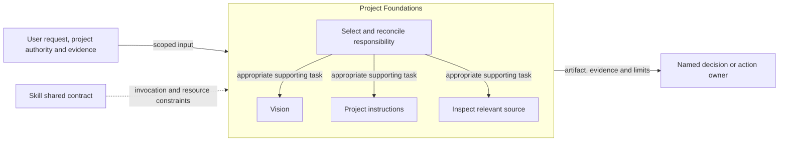
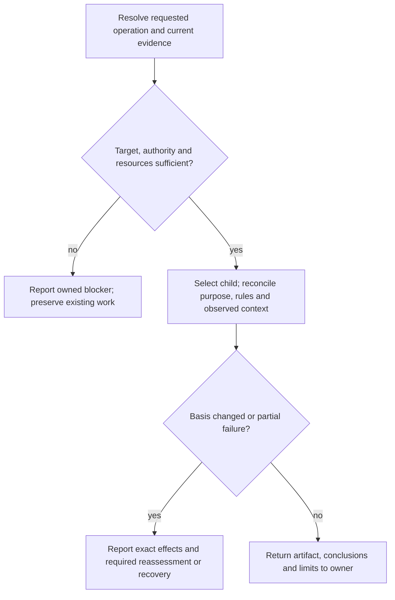

# Project Foundations Design

Owner: [MOD-008 Authoring guidance](module.json). This is supporting contract detail, not a separate REM entity. Source-qualified clause IDs retain their existing meaning.

Model validation contract: model-document-v1

Test scenarios and expected observations are defined in the single [system test design](../../../../../support/test-design/system-test-design.md).

## Responsibility and scope

Project Foundations composes project purpose, governing principles and observed repository orientation. It owns their consistency and handoff relationships; its activity contracts define the specialist artifacts.

Shared published invocation contract: [Skill](../../../MOD-018-engineering-operations/modules/MOD-012-published-engineering-capability-guidance/capability-contract.md). [Skill](../../../MOD-018-engineering-operations/modules/MOD-012-published-engineering-capability-guidance/capability-contract.md) retains shared invocation, evidence-access, resource and portability rules. [Workflow](../MOD-006-engineering-change-control/workflow.md) coordinates authorized activity; [Assessment](../MOD-007-engineering-verification-and-assurance/assessment.md) owns independent judgment and reliance. This decomposition changes no public invocation, stored format or external permission.

## Requirements

| ID | Required behavior |
| --- | --- |
| FOUND-SR-01 | Project Foundations MUST assign purpose/positioning to Vision, governing principles to project-selected instructions and observed orientation to direct source inspection without duplicating their detailed contracts. |
| FOUND-SR-02 | Cross-child inconsistencies MUST be exposed and returned to the appropriate authority; an observation MUST NOT silently redefine direction, governance or future architecture. |
| FOUND-SR-03 | Each child invocation MUST retain its scoped write, evidence, retry and artifact-placement boundaries; composition MUST NOT create a mandatory sequence or new governance adoption. |

## Project governance

Maintain existing project-selected instructions through ordinary authorized work. RigorLoop neither requires a Constitution artifact nor publishes a dedicated governance skill. Preserve equivalent existing customer guidance; a repository convention is not a universal filename or authority hierarchy.

| Retained clause | Required behavior |
| --- | --- |
| GOV-SR-01 | Governance edits MUST preserve project authority and equivalent existing guidance while making durable principles explicit and reviewable. |
| GOV-SR-02 | Disclose material conflicts, absent evidence and assumptions; do not silently replace higher-priority rules. |
| GOV-SR-03 | Identify changed rules and unresolved questions, linking to detailed owners instead of duplicating designs, workflows or temporary plans. |

These clauses retain the former governance-authoring obligations; the dedicated Constitution capability and GOV-DEC-01 decomposition are retired. No new skill or approval stage replaces them.

## Repository inspection

Inspect relevant source as part of ordinary work. README and the architecture overview supply entry points, not a required map-maintenance stage. Existing customer orientation documents remain optional inputs and retain their selected authority.

| Retained clause | Required behavior |
| --- | --- |
| MAP-SR-01 | Distinguish inspected structure, bounded inference and unknowns; intended architecture or filenames alone MUST NOT establish observed behavior. |
| MAP-SR-02 | Inspection MUST preserve the requested scope and authority; read-only work MUST NOT repair artifacts or mutate unrelated state. |
| MAP-SR-03 | Partial, stale or contradictory evidence MUST limit reliance; route actionable gaps to their responsible owner. |

The dedicated map create/refresh/audit vocabulary, root/area registration, required skeleton, freshness ceremony and MAP-DEC-01 specialist decomposition are retired. These retained evidence and authority safeguards require no replacement skill or document.

## Architecture Overview

The overview identifies the owned responsibility and external authority/evidence boundaries. Detailed behavior is in the contract sections below; output does not imply adoption or approval.

| View | Necessity and reason | Owning detail |
| --- | --- | --- |
| Context | No separate diagram: the overview and responsibility scope identify the request, shared contract and receiving owner without an additional external system boundary. | Responsibility and scope above. |
| Building Block | No separate diagram: the overview names each child and the inventory delegates its internals. | [Child responsibility inventory](#child-responsibility-inventory). |
| Runtime | Necessary: authority, resource failures and partial or blocked outcomes must remain distinct from successful handoff. | [Runtime view](#runtime-view). |
| Deployment | No separate diagram: this is published guidance, not a separately deployed service. Artifact placement is governed by the specialist and project contracts. | [Skill Deployment](../../../MOD-018-engineering-operations/modules/MOD-012-published-engineering-capability-guidance/capability-contract.md#deployment-view). |

## Child responsibility inventory

| Child | Owned behavior |
| --- | --- |
| [Vision](vision.md) | Canonical purpose and positioning with derived README synchronization. |
| Project-selected instructions | Reviewable governing principles, maintained through ordinary authorized edits; no dedicated skill or required filename. |
| Direct source inspection | Relevant current source, bounded inference and explicit unknowns; no required map artifact or dedicated skill. |

## Specialist contract

Vision expresses intended identity and outcomes; project instructions express governing principles; direct source inspection establishes current structure and bounded inference. These are complementary subjects, not interchangeable authority. Read only the activity contracts relevant to the requested change. A new vision does not prove that implementation already conforms; an inspection finding does not authorize changing either direction or governing rules.

Changes reconcile affected references and assumptions through their existing owners. The decision owner settles material positioning and governance conflicts; actual design or implementation gaps return to Authoring or Implementation under Workflow. Composition introduces no required Vision → instructions → inspection execution pipeline. Preserve existing artifact conventions and the common Skill source/resource boundary.

## Runtime view

The specialist contract determines the permitted action and retry, including read-only or preparation-only operations. A successful artifact write does not grant downstream execution. Reconcile changed basis before dependent work and report partial effects truthfully.

### Boundary scan and acceptance scenarios

| Dimension | Requirement basis | Distinct outcome to demonstrate |
| --- | --- | --- |
| Input domain | FOUND-SR-01, FOUND-SR-02, FOUND-SR-03 | A request selects purpose, governing principles or observed orientation according to its intended output. |
| State/lifecycle | FOUND-SR-01, FOUND-SR-02, FOUND-SR-03 | An orientation update does not mutate project direction or workflow progress. |
| Identity/authority | FOUND-SR-01, FOUND-SR-02, FOUND-SR-03 | Changing principles or positioning requires the relevant owner’s authority. |
| Composition/path | FOUND-SR-01, FOUND-SR-02, FOUND-SR-03 | An observed architecture inconsistency is routed to its Design owner without presenting intended behavior as observed implementation. |
| Temporal/retry | FOUND-SR-01, FOUND-SR-02, FOUND-SR-03 | A changed vision or governance basis triggers reassessment of affected consumers. |
| Failure/recovery | FOUND-SR-01, FOUND-SR-02, FOUND-SR-03 | A partial child update reports exact effects without treating the entire foundation as synchronized. |
| Compatibility/migration | FOUND-SR-01, FOUND-SR-02, FOUND-SR-03 | Existing artifact conventions and historical evidence retain their original authority. |
| External/environment | FOUND-SR-01, FOUND-SR-02, FOUND-SR-03 | Missing repository evidence limits orientation; installation does not establish customer governance. |

## Architecture Decisions

| ID | Decision and rationale | Alternatives and consequences |
| --- | --- | --- |
| FOUND-DEC-01 | Give Project Foundations one explicit current owner while retaining shared Skill policy and the specialist’s existing authority boundaries. | Keeping unrelated support duties together obscures responsibility. Duplicating their details in Skill would create competing owners; scoped extraction requires reconciled navigation and review. |

## Quality and limits

Review outcomes against actual inputs, authority and observable effects; structural checks alone do not establish adequacy. Preserve historical subjects, existing public vocabulary and required resource behavior. Unresolved material authority or evidence gaps stop dependent claims rather than inventing a successful outcome.
